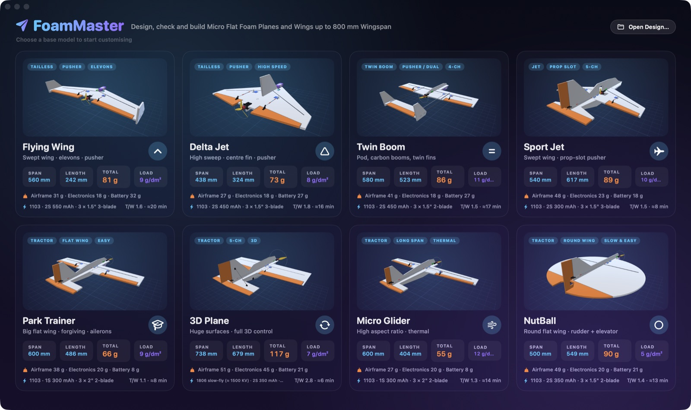
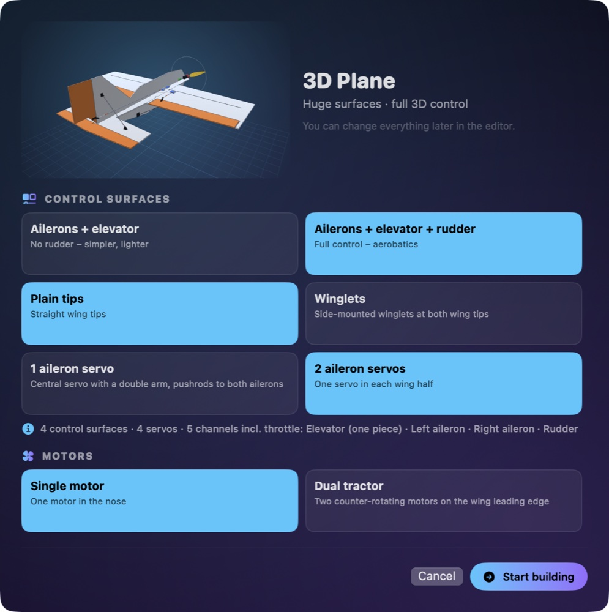
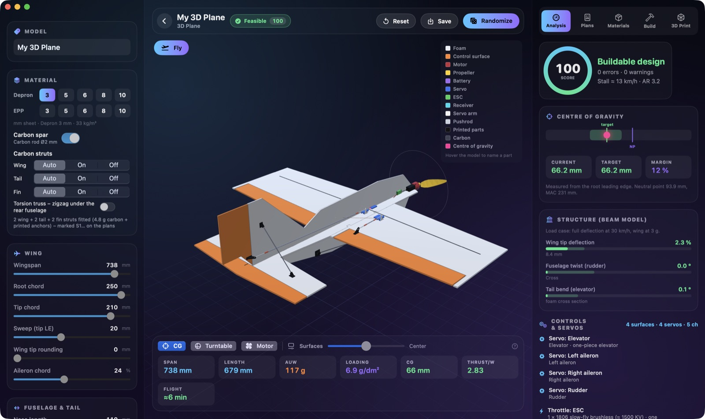
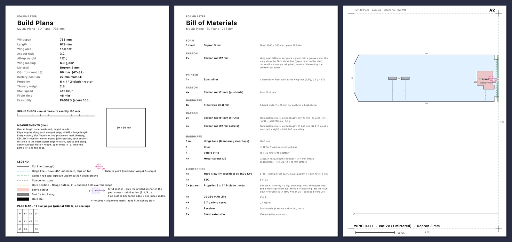
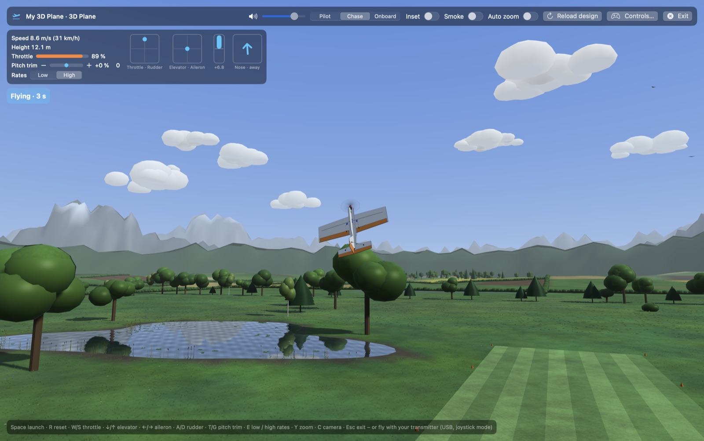

# FoamMaster

Native macOS app (SwiftUI + Metal) to design, check, build and fly micro flat-foam planes and wings up to **800 mm wingspan**.

Created by TriX aka Rock FPV – [YouTube](https://www.youtube.com/@RockFPV) · [GitHub](https://github.com/lydianb79/FoamMaster)



## Download

Get the zip for your Mac from the [Releases](https://github.com/lydianb79/FoamMaster/releases) page – `FoamMaster-<version>-build<build>-macOS-arm64.zip` for Apple silicon (M1 and later), `…-macOS-x86_64.zip` for Intel – unzip it and move `FoamMaster.app` to *Applications*. Requires macOS 14 or newer.

The app is not notarized: on first launch right-click it and choose **Open** (or allow it under *System Settings ▸ Privacy & Security*).

## What it does

- **Pick a type, get a buildable plane.** Eight base models – Flying Wing, Delta Jet, Twin Boom, Sport Jet, Park Trainer, 3D Plane, Micro Glider, NutBall. Every default and every setup option (controls, fins, winglets, aileron servos, single or dual motor) starts at score 100: no errors, no warnings, balanced at the recommended CG.
- **Change anything.** Sliders for wing, fuselage and tail, foam (Depron / EPP 3–10 mm), motor, prop, battery and servos – the power system and battery position follow automatically.
- **Checked like a real build.** Weight and CG, wing loading and stall speed, thrust / weight and flight time, tail volumes, wing and fuselage stiffness (with carbon spar, struts and an optional torsion truss), servo loads, prop clearance and every control surface swept through its full throw. If something fails, it says why and proposes the smallest fix.
- **Plans and parts.** 1:1 A4 PDF plans with every dimension, a bill of materials and build instructions; STL files for motor mounts, horns, strut anchors and the spar joiner.
- **Fly it before you cut it.** A flight simulator flies exactly the design on screen – with its weight, inertia, CG, trim, prop slipstream, torque and stall.



*Pick a type and its options – controls, wing tips, aileron servos, single or dual motor. The sheet sizes the build to pass every check before you start.*



*The editor: parameters on the left, the live 3D model with every component, analysis and checks on the right.*



*Plans: cover with the key figures, bill of materials, and 1:1 part sheets that tile across A4 pages.*

## Flight simulator



- Opens from **Fly** in the editor, in its own window. Pilot, chase and onboard cameras; an airfield with trees, a pond and mountains, sun shadows and sound.
- A 6-DOF model built from the design: lift and stall per wing strip, prop slipstream over the tail (hovering on the 3D Plane), motor torque and gyro effects, inertia from the real parts, and the elevator trimmed as built.
- Keyboard or a USB transmitter (joystick mode) with calibration, low / high rates with expo, and switches for launch, reset and rates.

## Build & run

```bash
./build_app.sh          # → build/FoamMaster.app (for this Mac)
open build/FoamMaster.app
./make_release.sh       # → build/release/FoamMaster-<version>-build<build>-macOS-{arm64,x86_64}.zip
```

Version and build number are set at the top of `build_app.sh`.

Requires Xcode / Swift 5.9+ and macOS 14+. `swift run` also works for quick iteration.

The app has command-line checks (`--setuptest`, `--simtest <dir>`, `--horncheck`, `--surfacecheck`, `--fuzz`, `--plans <dir>` and more) and `--screenshots <dir>`, which regenerates the screenshots above.

## Full documentation

Every construction rule, check, plan detail and the flight model are described in **[docs/FEATURES.md](docs/FEATURES.md)**.
